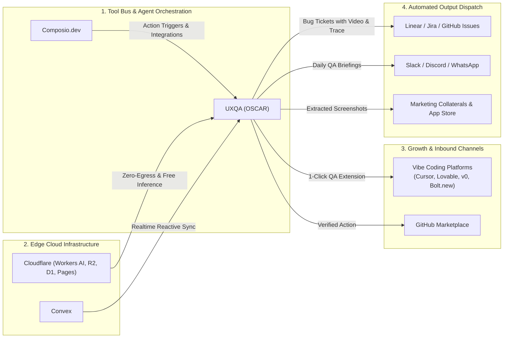

# UXQA (OSCAR) : Strategic Partnerships & Competitive Intelligence Matrix

> **Document Authority:** Radoss Digital Innovation & Product Strategy  
> **Brand & Project:** UXQA by Radoss. (Code name: `OSCAR`)  
> **Target Domains:** `https://uxqa.radoss.agency` | `https://uiqa-platform.pages.dev`  
> **Founder & Super Admin:** Uchenna Innocent (`uchenna@radossdigital.com` | Linked Cloudflare Account: `innosaint.uche@gmail.com`)

---

## 1. Executive Summary & Market Thesis

The global software testing market is undergoing a seismic structural inversion:
1. **The Human QA Downsizing:** Tech firms across the UK, US, and Europe have aggressively downsized manual QA departments to reduce operational overhead.
2. **The Vibe Coding Acceleration:** Non-traditional engineers, solo founders, and product leads are producing full-stack applications with AI tools (Cursor, v0, Lovable, Claude Code) at 10x traditional speed, producing silent regressions and conversion leaks.
3. **The Market Vacuum:** Existing testing tools are either **too expensive and complex** (BrowserStack, Datadog, UserTesting at \$2k–\$50k/yr) or **too primitive** (raw console assertion scripts).

**UXQA (OSCAR)** productises autonomous QA into a unified, zero-hardware cloud platform that integrates AI persona testing, UX copy review, and marketing asset extraction at a fraction of human or enterprise costs.

---

## 2. Competitive Intelligence Matrix

```
                          HIGH STRATEGIC VALUE (UX & Personas)
                                        │
                                        │       ★ UXQA (OSCAR)
                                        │       (Autonomous, Zero-Hardware,
                                        │        Personas, Copy & Collaterals)
             UserTesting.com            │
             (Human, £20k-£50k/yr,      │
              3-7 Day Turnaround)       │
                                        │
SLOW / EXPENSIVE ───────────────────────┼────────────────────── FAST / ACCESSIBLE
                                        │
             BrowserStack / SauceLabs   │       Playwright / Vitest CLI
             (Legacy Test Cloud,        │       (Local execution, 0 UX insight,
              £1,500-£5,000/yr,         │        eats 8GB laptop RAM)
              Complex Config)           │
                                        │
                          LOW STRATEGIC VALUE (Pure Raw Assertions)
```

### Detailed Competitor Breakdown

| Category & Competitors | Pricing & Commercial Model | Core Strengths | Critical Vulnerabilities & Blindspots | UXQA Displacement Strategy |
| :--- | :--- | :--- | :--- | :--- |
| **Legacy Cloud Test Grids**<br/>• BrowserStack<br/>• SauceLabs<br/>• LambdaTest | • \$1,500 to \$5,000+/year per seat.<br/>• Strict concurrency caps.<br/>• Annual lock-in contracts. | • Massive matrix of real physical devices and legacy OS versions. | • Zero qualitative feedback.<br/>• Requires full-time QA automation engineers to write scripts.<br/>• Zero UX copy or conversion audits.<br/>• Prohibitive for indie founders and vibe coders. | • **10x Simpler & 90% Cheaper:** Zero-configuration cloud runners via `cto-cloud-qa`.<br/>• Out-of-the-box simulated video playback and trace inspection without enterprise contracts. |
| **Human User Testing Platforms**<br/>• UserTesting.com<br/>• Applause<br/>• Maze<br/>• Lookback | • \$15,000 to \$50,000/year platform fees.<br/>• \$50 to \$120 per human reviewer session. | • Genuine human emotional responses and voice feedback. | • **Glacially slow:** Turnaround takes 3 to 7 days.<br/>• Cannot integrate into continuous git CI/CD deployment pipelines.<br/>• Prohibitive cost for pre-seed or bootstrap budgets. | • **Instant AI Persona Simulation:** Cloudflare Workers AI personas (Novice, Power User, Skeptical Buyer) provide comprehensive UX critique in **90 seconds** on every git push. |
| **Developer Synthetics & APM**<br/>• Datadog Synthetics<br/>• Checkly<br/>• New Relic | • Usage-based starting at \$600–\$3,000/year. | • Deep network APM tracing and uptime alerts. | • Built purely for SRE and DevOps teams.<br/>• No UI/UX design critique.<br/>• No microcopy review.<br/>• No reusable marketing asset extraction. | • **Product & Founder Centric:** Translates technical test runs into visual executive digests, design diffs, and marketing-ready screenshots. |
| **Local Headless Frameworks**<br/>• Raw Playwright / Cypress / Puppeteer | • Free open-source binaries. | • Industry standard browser automation APIs. | • **Hardware Bloat:** Freezes 8GB RAM laptops, consumes 4GB+ SSD storage for browser binaries, drains battery.<br/>• Complex reporting requiring local server hosting. | • **Zero Client Hardware Load:** Offloads 100% of execution to cloud Ubuntu VMs and Cloudflare R2 edge dashboards. |

---

## 3. Strategic Partnerships Ecosystem



### 3.1 Composio (`composio.dev`) Partnership Architecture
Composio is the premier integration fabric for AI agents, connecting LLMs to 250+ enterprise and developer tools.

#### Concrete Integration Capabilities for UXQA:
1. **Automated Defect Dispatch (Zero-Click Issue Creation):**
   * When an E2E suite fails or an AI persona detects a severe conversion blocker, Composio hooks automatically create structured tickets in **Linear, GitHub Issues, or Jira**.
   * Payload includes: The exact WebM video timestamp, step-by-step failure trace, console errors, DOM snapshot, and AI persona recommendation.
2. **Headless Browser Sandbox & Persona Exploration:**
   * Composio provides sandboxed browser execution environments. UXQA agents utilize Composio browser tool actions to explore unscripted exploratory paths (e.g. searching for edge-case 404s, testing international inputs, or probing broken links).
3. **Executive Notification Webhooks:**
   * Dispatches executive QA digests directly to founder Slack channels, Discord developer servers, or WhatsApp groups via Composio communication integrations.
4. **Co-Marketing Opportunity:**
   * Listing UXQA as a premier QA & Testing Tool on the official **Composio App Directory**, capturing inbound vibe coders and agent builders seeking testing solutions.

---

### 3.2 Cloudflare Technology Partnership & Case Study Alignment
* **Cloudflare Products Utilized:**
  * **Workers AI:** Free 10,000 Neurons/day for visual layout review (`llama-3.2-11b-vision-instruct`), UX copy audits (`llama-3.3-70b-instruct`), and persona reasoning (`qwen2.5-coder-32b-instruct`).
  * **R2 Object Storage:** 10 GB free forever with **\$0.00 egress fees** for storing large WebM video recordings, interactive trace zips, and high-resolution screenshots.
  * **D1 Edge Database:** 5M read rows/day for high-speed multi-tenant workspace records and user data.
  * **Pages & Workers Gateway:** Instant global edge routing under `uxqa.radoss.agency` and `uiqa-platform.pages.dev`.
* **Partnership Angle:**
  * Pitching UXQA as a featured case study on the **Cloudflare Developer Blog** (*"How UXQA Built a Zero-Egress Autonomous Product Testing Platform on Workers AI and R2"*), driving massive developer acquisition.

---

### 3.3 Distribution Alliances: Vibe Coding Platforms & IDEs
The fastest route to market is embedding UXQA into the developer workflow where code is generated:
1. **Cursor & Antigravity Extensions:** A lightweight CLI integration (`cto-cloud-qa`) allowing developers to trigger cloud E2E suites with one terminal command (`npx uxqa run`) and view test results directly in their editor.
2. **Bolt.new & Lovable.dev Integration:** Pre-configured GitHub Action templates bundled into exported repositories, providing instant cloud QA dashboard URLs on the first git push.
3. **GitHub Marketplace Verified Action:** Distributing `radoss/uxqa-action`, allowing any GitHub repository in the world to add continuous cloud QA in 3 lines of YAML.

---

## 4. Commercial Model & Packaging Strategy

```
┌─────────────────────────────────┐   ┌─────────────────────────────────┐   ┌─────────────────────────────────┐
│         COMMUNITY / MVP         │   │          FOUNDER TIER           │   │         PRO / AGENCY TIER       │
│             FREE                │   │         £29 / $39 / mo          │   │         £99 / $129 / mo         │
├─────────────────────────────────┤   ├─────────────────────────────────┤   ├─────────────────────────────────┤
│ • 1 Active Project              │   │ • 3 Active Projects             │   │ • 15 Active Projects            │
│ • 100 Cloud Test Runs / month   │   │ • 1,000 Cloud Test Runs / month │   │ • 5,000 Cloud Test Runs / month │
│ • 7-day WebM Video Retention    │   │ • 30-day Video & Trace Storage  │   │ • 90-day Video & Trace Storage  │
│ • Standard Pass/Fail Dashboard  │   │ • 3 Simulated AI Personas       │   │ • Custom Persona Calibration    │
│ • Community Support             │   │ • UX Copy & A/B Page Audits     │   │ • Composio Issue Sync (Linear)  │
│ • Waitlist Cohort Activation    │   │ • High-Res Marketing Exports    │   │ • Client-Branded QA Reports     │
└─────────────────────────────────┘   └─────────────────────────────────┘   └─────────────────────────────────┘
```

---

## 5. Strategic Execution Roadmap

1. **Phase 1 (Q4 2026):** Internal Dogfooding & Ecosystem Validation (AIRA Academy, Naija Grid, Radoss Digital clients).
2. **Phase 2 (Q1 2027):** Private Alpha Launch for Waitlist Founders with Cloudflare Workers AI persona reviews.
3. **Phase 3 (Q2 2027):** Composio integration release for automated Linear/GitHub defect dispatch and Slack QA digests.
4. **Phase 4 (Q3 2027):** Public launch on GitHub Marketplace, Product Hunt, and Cloudflare Developer Showcase.
